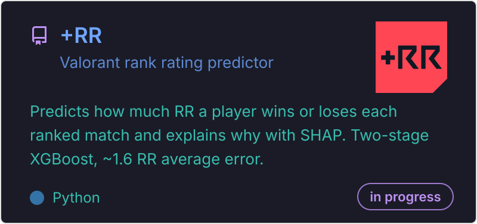
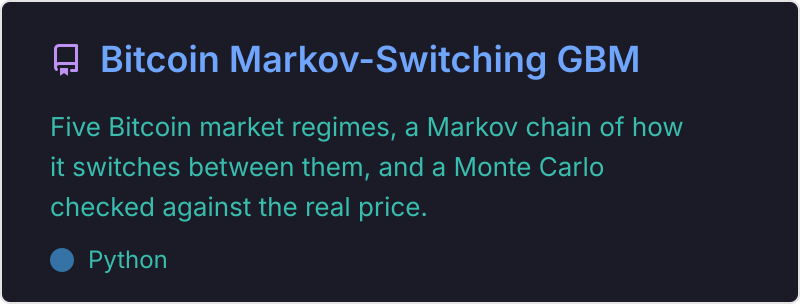

  

I study Actuarial Science and Data Science in Guadalajara, Mexico, and I'm working toward Machine Learning Engineering. I like taking a model past the notebook: clean data pipelines, models I can actually explain, and tools people can use.

<!-- Cambia TU-USUARIO-AQUÍ por tu URL real de LinkedIn -->

  
  

## What I'm building

**+RR** predicts how much RR you win or lose in a Valorant ranked match, and tells you why.

- Data pipeline that pulls real ranked matches from a Valorant stats API into my own dataset
- Two-stage XGBoost model, about 1.6 RR average error
- SHAP breaks every prediction into reasons that add up to your real RR
- Sanity check: the model's 5-stack penalty (~5 RR) matches the patch notes (5.3)

**Roadmap**
- [x] Data pipeline from the API
- [x] RR model + SHAP explanations
- [ ] Player archetypes with PCA + clustering (next)
- [ ] Serve the model as a REST API with FastAPI, plus a Streamlit app, all in Docker
- [ ] CI/CD with GitHub Actions: automated retraining when a patch shifts the meta, runs tracked in MLflow, and the new model only ships if it beats the current one
- [ ] Drift monitoring to know when it's time to retrain

## Other projects

  
  

## Tools

  
  
  
  
  
  
  
  

Learning now:

  
  
  
  

If you're working on ML for games, or anything with a lot of data behind it, I'd love to chat.
